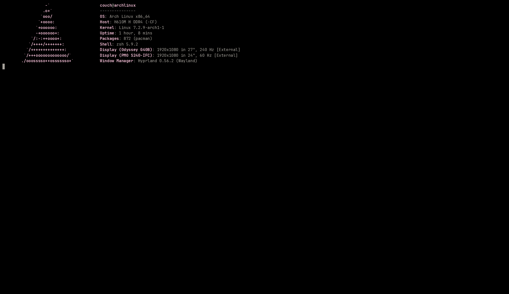

```
.▄▄ · ▄ •▄ ▄▄▄        ▄▄▌  ▄▄▌  .▄▄ · 
▐█ ▀. █▌▄▌▪▀▄ █·▪     ██•  ██•  ▐█ ▀. 
▄▀▀▀█▄▐▀▀▄·▐▀▀▄  ▄█▀▄ ██▪  ██▪  ▄▀▀▀█▄
▐█▄▪▐█▐█.█▌▐█•█▌▐█▌.▐▌▐█▌▐▌▐█▌▐▌▐█▄▪▐█
 ▀▀▀▀ ·▀  ▀.▀  ▀ ▀█▄▀▪.▀▀▀ .▀▀▀  ▀▀▀▀ 
```

## Skrolls

Skrolls is an open source text adventure like game, that refines how a textadventure could look.
The Game is all about Magic and Sorcery and you play a wizard yourself that has to defeat Monsters and complete Quests.
It features handcrafted and colored ASCII-Art animations and TUI-like interfaces for different screens like Inventory
and Battles.
The game also features background music and sound effects.

### The Creators

This game was made completely by two Indie Game Devs as part of a project

- [@CouchausenL](https://github.com/CouchhhausenL)
  - Made all the Ascii Assets and made the Battle System like Inventory and many Screens and the Game Logic and Story
- [@Nelson Khalil](https://github.com/NelsonKhalil)
  - Made the amazing Screen, Widget, ascii art animation parsing and verb system

### Features
- ASCII-Art animations
- round based Battles with combat effects and stat stages
- Mouse input support
- Windowed mode
- Items and Inventory
- Scenes with navigation
- Screen and Widget system
- A large Map with lots of Story
- Verb-based command input with live autocompletion and suggestions
- Spell and Scroll system
- Magic types with an effectiveness matrix (super/neutral/resisted)
- Equipment slots (staff, armor, artifacts, scrolls) with equip/unequip commands
- Item quality tiers (Common to Mythic)
- Many different monsters all featuring individual idle and attack animations
- Text-adventure message log and scrolling UI
- Dialogue system (typewriter text, text/boolean answers)
- Interactive tutorial
- NPC and interactable objects like chests in Scenes
- Quest System
- basic Save and Loading of Gamestates

### Installation

The whole game is bundeled as a portable .jar file, you can run it in a Terminal using:

```
java -jar skrolls.jar
```

Or if you prefer a regular Swing Window please use:

```
java -jar skrolls.jar --window
```

The terminal versions works great in Terminals like Kitty, Alacritty, Ghosty or Foot, Windows Powershell lacks some
Mouse Input options. The Windowed Version has some input detection bugs under Linux.  \
Please note that you need to have java installed!

### Notice

Please mind this game is partially still in development, and it may have some unpolished Artifacts in Gameplay. Music
and Sound Effects are selected random because Life and especially Magic is Random!

### AI Disclosure

-> see [AI_DISCLOSURE.md](./AI_DISCLOSURE.md)

### Task Completion

-> see [TASK_COMPLETION.md](./TASK_COMPLETION.md)

###

This Game was a hell amount of work do develop (6800+ lines of code, 6200+ lines of definitions) so please enjoy it!
```
   *   \,                                   ,/   *
   |   _\`,_        " Have Fun! "        _,'/_   |     
   \`, `(")'                             `(")' ,'/     
   \ \.-H-,_ _                         _ _,-H-./ /     
    \   ./_/_/                         \_\_\.   /      
      )  | "(                           )" |  (        
 __/   H   \__                         __/   H   \__   
 \    /|\    /                         \    /|\    /   
   `--'|||`--'                         `--'|||`--'     
      ==^==                               ==^==                                                                             
```

## Showcase


(1,5x speed)