```
.▄▄ · ▄ •▄ ▄▄▄        ▄▄▌  ▄▄▌  .▄▄ · 
▐█ ▀. █▌▄▌▪▀▄ █·▪     ██•  ██•  ▐█ ▀. 
▄▀▀▀█▄▐▀▀▄·▐▀▀▄  ▄█▀▄ ██▪  ██▪  ▄▀▀▀█▄
▐█▄▪▐█▐█.█▌▐█•█▌▐█▌.▐▌▐█▌▐▌▐█▌▐▌▐█▄▪▐█
 ▀▀▀▀ ·▀  ▀.▀  ▀ ▀█▄▀▪.▀▀▀ .▀▀▀  ▀▀▀▀ 
```

## Task Completion
- User input has a direct effect on the game
- The program has no known errors, except those listed in `Shortcomings`
- The program is well commented, AI was used, check `Aids / Tools`
- The program uses many different classes
- The program respects OOP principles by using getters/setters and limited view-like contexts
- The program uses OOP concepts such as:
  - Inheritance
  - Encapsulation
  - Polymorphism
  - Abstraction (abstract classes and interfaces)
- The program uses Java language features complementing OOP such as:
  - Generics
  - Records
  - Enums
  - Exceptions
- A class diagram exists, see `Class Diagram` and `Aids / Tools`

## Features
- ASCII-Art animations
- Battles
- Mouse input support
- Windowed mode
- Items
- Scenes with navigation
- Screen and Widget system
- Map Screen
- Verb-based command input with live autocompletion and suggestions
- Spell and Scroll system
- Magic types with an effectiveness matrix (super/neutral/resisted)
- Equipment slots (staff, armor, artifacts, scrolls) with equip/unequip commands
- Item quality tiers (Common to Mythic)
- Many different monsters
- Text-adventure message log and scrolling UI
- Dialogue system (typewriter text, text/boolean answers)
- Interactive tutorial

## Class Diagram

Complete:


Minified: (Scene and Spell boilerplate removed)


## Aids / Tools
- AI was used for:
  - Generating a html/css/js based .ska animation editor
  - Generating a html/css/js based uml class diagram generator with mermaid rendering
  - Generating convert_jmov_animation.py
  - Generating generate_scroll_items.py
  - Adding logging to convert_ascii_motion_animation.py
  - Adding/Correcting/Expanding comments throughout the codebase
  - Generating rough structure of some ASCII animations
  - Generating boilerplate item definitions
  - Generating boilerplate spell definitions

- AI was _not_ used for:
  - Generating non-boilerplate java code
  - Generating essential and/or algorithmic java code

- What tools were used for:
  - Generating UML class diagrams
  - Editing .ska animations
  - Version control

## Shortcomings
- The project has grown far beyond what the task was meant to encompass and therefore:
  - Has 4500+ lines of code (7000+ when counting boilerplate definitions)
  - Has 100+ source files (220+ when counting boilerplate scene and spell definitions)
  - Relies on many critical systems (screen, widget, scene) which are not strictly necessary for a 2-week project
- Many planned features were never fully implemented in-game:
  - Storyline
  - Crystallized mana currency system
  - Interactables in scenes
  - Warping system
  - Save-state system
  - ...
- Many classes/features are rushed and therefore:
  - Not completely integrated
  - Not written to the highest of OOP standards
  - Missing (non-necessary) @NotNull and @Nullable
  - Missing concrete null checks in many places
  - Missing setter checks in some places


```
        ,/   *
  _,'/_   |            " Have Fun! "
  `(")' ,'/
_ _,-H-./ /
\_\_\.   /
 )" |  (
__/   H   \__
\    /|\    /
`--'|||`--'
  ==^==

```